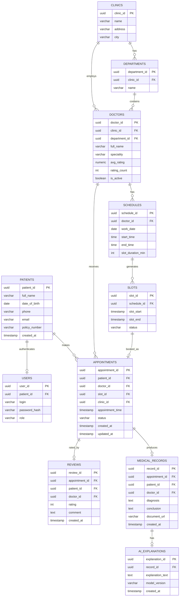

# Расчетно-пояснительная записка (ЕМИАС)

## Тема
Тема курсового проекта – сервис для электронной записи к врачу (за основу берется ЕМИАС).

## Целевая аудитория
Несмотря на имеющуюся статистику [^1], на данный момент инструменты показывают, что mau составляет около 900 тыс.[^2] Учитывая, что ЕМИАС используется только жителями Москвы, при масштабировании на аудиторию России сервис может рассматриваться как высоконагруженный, mau > 10 млн.

## Функционал
### Ключевой функционал:
1. Регистрация и авторизация.
2. Поиск врачей.
3. Просмотр расписания врача.
4. Запись, отмена и перенос приема.
5. Напоминание о приеме.
6. Рейтинг врача.
7. ИИ-пояснение заключения.

### Ключевые продуктовые решения
1. Для записи на прием необходима авторизация.
2. Отображение в расписании только свободных слотов.
3. Оценку врачу пользователь может поставить только после посещения приема.
4. ИИ-пояснение формируется внешним сервисом на основе выводов врача, не ставит диагноз.

## Продуктовые метрики

### Исходные данные

Для пересчёта аудиторных метрик в продуктовые используются следующие подтверждённые значения:

- **MAU (Москва):** ~900 тыс. по данным инструментов.
- **DAU (Москва):** приближается к **300 тыс.** — по данным о ежедневных подключениях к «ЕМИАС.ИНФО».
- **Общее число записей через ЕМИАС за год:** >80 млн[^4] записей к врачам за 2024 год, что даёт ~200–220 тыс. записей в день.
- **Общее число цифровых записей в ЭМК:** >4,7 млрд, ежедневно добавляется ~1,5 млн новых[^5].
- **Число пользователей с доступом к ЭМК:** >10 млн человек.

### Продуктовые метрики

**Среднее количество действий в день.** Health-приложения в среднем запускаются 2,8 раза в день на одного активного пользователя. Однако ЕМИАС — не трекер здоровья, а сервис транзакционного типа: основное действие — запись или просмотр информации. Пользовательский путь включает: открытие приложения (1), просмотр расписания (1), запись или отмену (1), проверку заключения (1). Принимаем **4 действия в день** на DAU.

**Средний размер хранилища на пользователя.** Сервис не хранит тяжёлые медицинские изображения (МРТ, КТ). Основные данные: профиль (~10 КБ), история записей (~2 КБ на запись), текстовые заключения (~1–2 КБ) и вложения (PDF-сканы, до 500 КБ–1 МБ на документ). По данным ЕМИАС, с момента открытия доступа пользователи загрузили >4,8 млн медицинских документов при ~6 млн пользователей — это ~0,8 документа на пользователя за 5 лет. При среднем размере документа 500 КБ (типичный размер сканированного PDF) получаем ~400 КБ на пользователя. С учётом «Дневника здоровья» (более 330 млн записей на ~6 млн пользователей = ~55 записей на пользователя, каждая ~1 КБ) добавляется ~55 КБ. Итого: **~50 МБ на пользователя** — округление с запасом на рост вложений.

### Сводная таблица продуктовых метрик

| Метрика | Москва | Россия | Источник / логика |
|---|---|---|---|
| MAU | 900 тыс. | 10 млн | [^1]/[^2] |
| DAU | ~225 тыс. | ~2,5 млн | MAU × 25% (допущение на основе бенчмарка DAU/MAU) |
| Среднее действий/день на DAU | 4 | 4 | Бенчмарк 2,8 запусков для health-приложений + транзакционная специфика |
| Общее действий/день | ~900 тыс. | ~10 млн | DAU × 4 |
| Среднее хранилище на пользователя | 50 МБ | 50 МБ | 0,8 документа × 500 КБ + 55 записей × 1 КБ |
| Всего хранилище (пользователи) | ~45 ТБ | ~500 ТБ | MAU × 50 МБ |

## Технические метрики

### Размер хранения по типам данных

Разобьём данные на три существенных блока. Примем срок хранения за 5 лет.

**1. Профили и учётные записи.** ~10 КБ на пользователя (ФИО, полис, телефон, настройки). При 900 тыс. MAU: ~9 ГБ. Для России (10 млн MAU): ~100 ГБ.

**2. Записи и расписание.** ~2 КБ на запись. По данным ЕМИАС: ~80 млн записей за 2024 год. За 5 лет — ~400 млн записей. Объём: 400 млн × 2 КБ = ~800 ГБ. Для России (коэффициент масштабирования 10): ~8 ТБ.

**3. Заключения и вложения.** ~500 КБ на документ (PDF + текст). По данным ЕМИАС: >4,8 млн документов при ~6 млн пользователей за 5 лет[^3]. Для 900 тыс. MAU: ~720 тыс. документов × 500 КБ = ~360 ГБ. Для России: ~3,6 ТБ. С учётом текстовых заключений (без вложений): ~1 КБ × 200 тыс. приёмов/день × 365 × 5 = ~365 ГБ (Москва) / ~3,65 ТБ (Россия). Итого по блоку: **~725 ГБ** (Москва) / **~7,25 ТБ** (Россия).

| Тип данных | Москва, 5 лет | Россия, 5 лет |
|---|---|---|
| Профили | ~9 ГБ | ~100 ГБ |
| Записи и расписание | ~800 ГБ | ~8 ТБ |
| Заключения и вложения | ~725 ГБ | ~7,25 ТБ |
| Итого | **~1,5 ТБ** | **~15,3 ТБ** |

### Сетевой трафик

**Пиковое потребление в течение суток.** По данным ЕМИАС, пик обращений — с 9:00 до 12:00. При среднем размере ответа ~23 КБ:

- Пиковый RPS: ~7 088
- Пиковый трафик: 7 088 × 23 КБ ≈ 163 МБ/с ≈ 1,3 Гбит/с
- Максимальный секундный RPS: ~14 000
- Максимальный секундный трафик: 14 000 × 23 КБ ≈ 322 МБ/с ≈ 2,6 Гбит/с

С учётом вложений (PDF): ~200 тыс. приёмов в день, из которых ~20% пользователей скачивают заключение = ~40 тыс. PDF/день × 500 КБ ≈ 20 ГБ/сутки, что на пиковый сетевой интерфейс влияет пренебрежимо. Итого пиковый трафик (Россия): ~1,3 Гбит/с (средний по пиковому часу), ~2,6 Гбит/с(максимальная секунда).По верхней границе возьмем **10 Гбит/с** с запасом.

**Суммарный суточный трафик:**

- API-вызовы: 153 млн × 23 КБ ≈ 3,5 ТБ/сутки
- Вложения: 40 тыс. скачиваний × 500 КБ ≈ 20 ГБ/сутки
- **Итого: ~3,5 ТБ/сутки**

### RPS по типам запросов

Средний RPS = общее число запросов в сутки / 86400. Пиковый = средний × коэффициент пиковости. Для сервиса с утренним пиком коэффициент 3–4.

| Метод | Доля от действий | Средний RPS | Пиковый RPS (×4) |
|---|---|---|---|
| Авторизация | 5% | ~89 | ~356 |
| Поиск врача | 15% | ~266 | ~1 064 |
| Просмотр расписания | 20% | ~354 | ~1 416 |
| Запись / отмена / перенос | 15% | ~266 | ~1 064 |
| Просмотр заключения | 25% | ~443 | ~1 772 |
| Напоминания (push/read) | 10% | ~177 | ~708 |
| Рейтинг | 5% | ~89 | ~356 |
| ИИ-пояснение | 5% | ~89 | ~356 |
| **Итого** | 100% | **~1 772** | **~7 088** |

# 3. Глобальная балансировка нагрузки

## 3.1. Функциональное разбиение по доменам

| Домен | Функции | Профиль нагрузки | Критичность |
|---|---|---|---|
| **Клиентский API** | Авторизация, поиск врачей, расписание, запись/отмена, просмотр заключений, рейтинг, push | Высокий RPS, чувствителен к задержке | Критичный |
| **Данные и ЭМК** | Хранение профилей, записей, заключений, дневника здоровья, документов | Низкий RPS, большой объём хранения | Критичный |
| **Интеграции** | Внешний ИИ-сервис | Средний RPS, асинхронный | Некритичный |

## 3.2. Карта расположения ДЦ

Расположим четыре дата-центра на территории России.

**Активные:**

- Москва (ДЦ-1) — 40% трафика. Расположена в центре европейской части. Около 8,5 млн интернет-пользователей, MSK-IX. Наибольший пул пользователей и крупнейшая точка обмена трафиком.
- Санкт-Петербург (ДЦ-2) — 20% трафика. Северо-запад России, к северу от Москвы. Примерно 3,5 млн интернет-пользователей, ~10 мс до Москвы. Второй по размеру пул, ближайший к Москве активный ДЦ.
- Новосибирск (ДЦ-3) — 25% трафика. Центр Сибири, значительно восточнее Москвы. Только в городе ~1 млн интернет-пользователей, ~42 мс до Москвы. Покрытие Сибири и Дальнего Востока.
- Удомля (ДЦ-4) — 15% трафика. Тверская область, между Москвой и Санкт-Петербургом. Калининская АЭС. Активно участвует в трафике, принимает часть нагрузки с Москвы и СПб.

## 3.3. Распределение запросов по ДЦ

**Как считается.** Доля ДЦ = (интернет-пользователи региона / общее число) × коэффициент ёмкости. Основной фактор — географическая близость для минимизации задержки.

**Распределение по регионам:**

Предположение: Москва — 40% трафика, СПб — 20%, Новосибирск — 25%, Удомля — 15%.

**Распределение запросов по типам (Россия, 10 млн MAU):**

| Тип запроса | Средний RPS | Пиковый RPS | ДЦ-1 (40%) | ДЦ-2 (20%) | ДЦ-3 (25%) | ДЦ-4 (15%) |
|---|---|---|---|---|---|---|
| Авторизация | ~89 | ~356 | ~36 | ~18 | ~22 | ~13 |
| Поиск врача | ~266 | ~1 064 | ~106 | ~53 | ~67 | ~40 |
| Просмотр расписания | ~354 | ~1 416 | ~142 | ~71 | ~89 | ~53 |
| Запись / отмена | ~266 | ~1 064 | ~106 | ~53 | ~67 | ~40 |
| Просмотр заключения | ~443 | ~1 772 | ~177 | ~89 | ~111 | ~66 |
| Напоминания | ~177 | ~708 | ~71 | ~35 | ~44 | ~27 |
| Рейтинг | ~89 | ~356 | ~36 | ~18 | ~22 | ~13 |
| ИИ-пояснение | ~89 | ~356 | ~36 | ~18 | ~22 | ~13 |
| **Итого** | **~1 772** | **~7 088** | **~709** | **~354** | **~443** | **~266** |

## 3.4. Схема DNS-балансировки

GSLB возвращает IP ближайшего доступного ДЦ на основе: геолокации, задержки, доступности.

**Схема:** пользователь → DNS-запрос `api.emias-clone.ru` → GSLB-кластер → правила: Москва→ДЦ1, СПб→ДЦ2, Сибирь→ДЦ3, Удомля→ДЦ4, fallback→ДЦ1 → ДЦ-1 (40%), ДЦ-2 (20%), ДЦ-3 (25%), ДЦ-4 (15%).

**Возможная реализация:**
- Health checks: проверка доступности каждые 5 секунд; 3 фейла (15 секунд) → исключение из DNS.
- TTL DNS: 30 секунд.
- Weighted routing: веса 40/20/25/15, при недоступности пересчитываются автоматически.
- GeoDNS: для Сибири и ДВ возвращается IP Новосибирска.
- Fallback: если регион не определён — ДЦ-1.

## 3.5. Механизм регулировки трафика между ДЦ

**Три уровня:**

| Уровень | Механизм | Что регулирует |
|---|---|---|
| DNS (GSLB) | GeoDNS + health checks + веса | Трафик между ДЦ |
| L4 (LB) | Weighted least connections | Запросы между подами внутри ДЦ |
| L7 (API Gateway) | Rate limiting | Защита от перегрузки |

**Регулировка при деградации:**

*ДЦ-1 недоступен:* health check не проходит 3 раза (15 секунд), ДЦ-1 исключается из GSLB, веса пересчитываются: ДЦ-2 = 33%, ДЦ-3 = 42%, ДЦ-4 = 25%.

*Плановое обслуживание ДЦ-2:* вес вручную снижается до 0%, трафик перераспределяется на ДЦ-1, ДЦ-3 и ДЦ-4, через 30 секунд ДЦ-2 пуст.

## 4. Локальная балансировка нагрузки

### 4.1. Схема балансировки нагрузки

Балансировка внутри каждого ДЦ построена на трёх уровнях. Каждый уровень решает свою задачу и имеет собственное резервирование.

#### Уровень 1. L4 (транспортный)

Принимает TCP-соединения от пользователей, которые пришли в ДЦ по IP, выданному GSLB. Не смотрит внутрь трафика, работает с пакетами. Два балансировщика в режиме active-active, между ними виртуальный IP через VRRP/Keepalived. Если один падает, VIP переезжает на второй за секунды. Резервирование — N+1: два активных плюс один резервный, который находится в горячем состоянии (конфигурация синхронизирована, health checks идут), но не принимает трафик в штатном режиме. Распределяет TCP-соединения между L7-балансировщиками по алгоритму least connections.

#### Уровень 2. L7 (прикладной)

Терминирует SSL/TLS, читает HTTP-заголовки, маршрутизирует запросы по путям (`/api/v1/auth` и т.д.). Используется NGINX Ingress Controller в Kubernetes, два экземпляра в active-active. Каждый держит собственный набор сертификатов, синхронизированных через общий Secret. Резервирование — N+1: два активных плюс один резервный, который поднимается автоматически при отказе одного из активных (третий под получает трафик только при отказе). Распределяет HTTP-запросы между подами приложения .

#### Уровень 3. Уровень подов

Kubernetes Service распределяет запросы между конкретными экземплярами приложения. Механизм — ClusterIP Service плюс kube-proxy в режиме IPVS. Каждый под имеет readiness probe: если под не отвечает, Service исключает его из ротации. Резервирование — N+2: минимум два пода на каждый сервис. При отказе одного пода второй берёт всю нагрузку, Kubernetes автоматически пересоздаёт упавший под. Распределяет запросы между подами одного сервиса (например, 10 подов auth-service).

#### Сводная схема уровней

| Уровень | Компонент | Механизм | Резервирование |
|---|---|---|---|
| L4 | HAProxy + Keepalived | VIP, least connections | N+1 (2 активных + 1 резерв) |
| L7 | NGINX Ingress Controller | SSL termination, round-robin | N+1 (2 активных + 1 резерв) |
| Поды | Kubernetes Service | IPVS, readiness probe | N+2 (минимум 2 пода на сервис) |

### 4.2. Формула резервирования

Выберем схему **N+1**: На N рабочих узлов приходится один резервный. Если один из N рабочих выходит из строя, резервный берёт его нагрузку. Система продолжает работать без деградации.

**Почему N+1?**

- N+2 даёт защиту от одновременного отказа двух узлов. Для этого нужны независимые причины отказа (разные стойки, разные ДЦ). Внутри одного ДЦ это избыточно.
- 2N — полное дублирование. Используется для самых критичных компонентов (например, хранилище данных). Для балансировщиков это дорого и не даёт пропорционального выигрыша.
- N+1 — стандарт для балансировщиков. Один резервный узел покрывает отказ одного рабочего. Если откажут два одновременно — это уже сценарий катастрофы, и его обрабатывает GSLB на уровне между ДЦ.

**Формула:**

N_итого = N_рабочих + 1_резервный

Где N_рабочих — минимальное число узлов, необходимое для обработки пиковой нагрузки с запасом.

Для L4 и L7: N_рабочих = 2, потому что нужен active-active для распределения нагрузки и отказоустойчивости. Итого 3 узла на каждый уровень.

Для подов: N_рабочих = 2 (минимум), N+2 даёт 4 пода на сервис при пиковой нагрузке.

### 4.3. Расчёт количества балансировщиков

#### Ограничители

**Ограничитель 1: SSL Termination (CPS) для L7.**

Из тестов веб-сервера NGINX (2017) на 8 CPU: 3 399 HTTPS CPS[^6]. С учётом целевой утилизации u=0,7 получаем **2 379,3 CPS** на один балансировщик.

**Ограничитель 2: пропускная способность сети для L7.**

Из тестов NGINX Ingress Controller (2019) на 8 CPU: 8,64 Гбит/с полезной нагрузки на один балансировщик. С учётом u=0,7 получаем **6,048 Гбит/с**.

Для L4 (HAProxy на 4 CPU) ограничителем является только пропускная способность сети, так как терминация TLS не выполняется. Один узел на 4 CPU легко обрабатывает до 8,6 Гбит/с, поэтому для покрытия пиковой нагрузки достаточно 1 активного балансировщика на каждый ДЦ.

#### Формула

```text
N_L7 = max( Пиковый_TPS_ДЦ / 2 379,3, Пиковый_трафик_ДЦ / 6,048 ) × Коэф_резервирования
N_L4 = 1 (активный) × Коэф_резервирования
```

Где Коэф_резервирования = 1,5 для N+1 (округляется вверх).

#### Исходные данные по ДЦ

Пиковые значения из раздела 3 распределяются по ДЦ в соответствии с весами:

| ДЦ | Доля трафика | Пиковый RPS | Макс. секундный RPS | Пиковый трафик |
|---|---|---|---|---|
| Москва (ДЦ-1) | 40% | 2 835 | 5 600 | 1,04 Гбит/с |
| СПб (ДЦ-2) | 20% | 1 418 | 2 800 | 0,52 Гбит/с |
| Новосибирск (ДЦ-3) | 25% | 1 772 | 3 500 | 0,65 Гбит/с |
| Удомля (ДЦ-4) | 15% | 1 063 | 2 100 | 0,39 Гбит/с |

#### Расчёт L7 по каждому ДЦ (8 CPU)

**Москва (ДЦ-1):**
- По CPS: 5 600 / 2 379,3 ≈ 2,35 → 3 активных.
- По трафику: 1,04 / 6,048 ≈ 0,17 → 1 активный.
- Максимум: 3 активных. С резервированием N+1: 3 + 1 = **4**.

**СПб (ДЦ-2):**
- По CPS: 2 800 / 2 379,3 ≈ 1,17 → 2 активных.
- По трафику: 0,52 / 6,048 ≈ 0,08 → 1 активный.
- Максимум: 2 активных. С резервированием N+1: 2 + 1 = **3**.

**Новосибирск (ДЦ-3):**
- По CPS: 3 500 / 2 379,3 ≈ 1,47 → 2 активных.
- По трафику: 0,65 / 6,048 ≈ 0,11 → 1 активный.
- Максимум: 2 активных. С резервированием N+1: 2 + 1 = **3**.

**Удомля (ДЦ-4):**
- По CPS (штатный режим): 2 100 / 2 379,3 ≈ 0,88 → 1 активный.
- По CPS (аварийный режим, прием +15% от Москвы): 4 200 / 2 379,3 ≈ 1,76 → 2 активных.
- По трафику: 0,39 / 6,048 ≈ 0,06 → 1 активный.
- Максимум: 2 активных (закладываем запас на аварию в Москве/СПб). С резервированием N+1: 2 + 1 = **3**.

#### Расчёт L4 по каждому ДЦ (4 CPU)

HAProxy не терминирует TLS. Пропускная способность одного узла с 10G NIC превышает пиковый трафик любого ДЦ с большим запасом. Для каждого ДЦ: 1 активный + 1 резервный = **2**.

#### Итоговая таблица

| ДЦ | L4 балансировщиков (4 CPU) | L7 балансировщиков (8 CPU) | Всего |
|---|---|---|---|
| Москва (ДЦ-1) | 2 (1 актив + 1 резерв) | 4 (3 актив + 1 резерв) | 6 |
| СПб (ДЦ-2) | 2 (1 актив + 1 резерв) | 3 (2 актив + 1 резерв) | 5 |
| Новосибирск (ДЦ-3) | 2 (1 актив + 1 резерв) | 3 (2 актив + 1 резерв) | 5 |
| Удомля (ДЦ-4) | 2 (1 актив + 1 резерв) | 3 (2 актив + 1 резерв) | 5 |
| **Итого** | **8** | **13** | **21** |

Резервный балансировщик добавляется для отказоустойчивости (схема N+1).

### 4.4. Итог

| Параметр | Значение |
|---|---|
| Схема резервирования | N+1 для всех уровней |
| L4-балансировщиков на ДЦ | 2 (1 актив + 1 резерв) на 4 CPU |
| L7-балансировщиков на ДЦ | от 3 до 4 на 8 CPU |
| Всего балансировщиков | 21 (8 L4 + 13 L7) |
| Ограничитель по CPS | 2 379,3 CPS на балансировщик (8 CPU) |
| Ограничитель по трафику | 6,048 Гбит/с на балансировщик (8 CPU) |
| Использование мощности | ~70% (u=0,7), в Удомле заложен запас на аварийный переток |


## 5. Логическая схема БД

### 5.1. Принципы проектирования

Логическая схема построена вокруг трёх ключевых доменов, выделенных в разделе 3.1: клиентский API, данные и ЭМК, интеграции и ИИ.

Схема нормализована до 3НФ, за исключением нескольких денормализованных полей (например, `avg_rating` в таблице `doctors`), введённых для ускорения чтения. «Файловые» данные (PDF-заключения, сканы) хранятся в объектном хранилище (S3-совместимом), а в БД — только метаданные и ссылки. Кеши (Redis) и буферы (Kafka) вынесены за пределы реляционной схемы, но описаны в таблице 5.2.

### 5.2. ER-диаграмма


### 5.3. Описание таблиц, размеры и QPS

Данные о размерах основаны на оценках из разделов 2 и 3: 10 млн MAU, ~80 млн записей в год, ~4,8 млн медицинских документов. Нагрузка (QPS) рассчитана исходя из пикового RPS 14 000 (раздел 3.4) с допущением, что ~40% запросов требуют обращения к БД (остальное — кеш и статика).

**Основные таблицы**

| Таблица | Назначение | Ключевые поля | Оценка строк (5 лет) | Средний размер строки | Общий объём | QPS (чтение / запись) | Требования к консистентности |
|---|---|---|---|---|---|---|---|
| `patients` | Профили пациентов | `patient_id` (PK), ФИО, полис, телефон | 10 млн | ~1 КБ | ~10 ГБ | 800 / 50 | Строгая (ACID) для персональных данных |
| `doctors` | Врачи, специальности, рейтинг | `doctor_id` (PK), `clinic_id`, `avg_rating` | 200 тыс. | ~500 Б | ~100 МБ | 1200 / 10 | Строгая для рейтинга, eventual для остального |
| `clinics` | Медицинские учреждения | `clinic_id` (PK), адрес, город | 5 тыс. | ~2 КБ | ~10 МБ | 300 / 0 | Строгая |
| `departments` | Отделения внутри клиник | `department_id` (PK), `clinic_id` | 20 тыс. | ~200 Б | ~4 МБ | 200 / 0 | Строгая |
| `schedules` | Шаблоны расписания врача | `schedule_id` (PK), `doctor_id`, дата, время | 5 млн (по дням) | ~100 Б | ~500 МБ | 600 / 20 | Строгая (уникальность слотов) |
| `slots` | Конкретные временные слоты | `slot_id` (PK), `schedule_id`, время, статус | 100 млн | ~100 Б | ~10 ГБ | 2500 / 800 | **Строгая** (запрет двойного бронирования) |
| `appointments` | Записи на приём | `appointment_id` (PK), `patient_id`, `slot_id`, статус | 400 млн | ~2 КБ | ~800 ГБ | 1500 / 300 | **Строгая** (ACID, транзакции) |
| `medical_records` | Заключения и диагнозы | `record_id` (PK), `appointment_id`, `document_url` | 400 млн | ~5 КБ (текст) + ссылка | ~2 ТБ | 800 / 100 | Строгая для текста, eventual для ссылок |
| `ai_explanations` | ИИ-пояснения к заключениям | `explanation_id` (PK), `record_id` | 400 млн | ~2 КБ | ~800 ГБ | 300 / 50 | Eventual (асинхронная генерация) |
| `reviews` | Оценки и отзывы | `review_id` (PK), `appointment_id`, rating | 400 млн | ~500 Б | ~200 ГБ | 400 / 20 | Строгая для рейтинга (пересчёт `avg_rating`) |
| `users` | Учётные записи | `user_id` (PK), `patient_id`, `login` | 10 млн | ~300 Б | ~3 ГБ | 1000 / 30 | Строгая (безопасность) |

**Пояснения к QPS:**
Чтение преобладает (read-heavy) из-за поиска врачей, просмотра расписания и заключений. Пиковые QPS на запись (например, `slots` — 800) возникают в моменты массовой записи (утренний пик). Таблицы `slots` и `appointments` — самые нагруженные по записи, требуют транзакционной целостности.

**«Файловые» данные, кеши и буферы**

| Компонент | Что хранит | Объём | QPS / throughput | Консистентность |
|---|---|---|---|---|
| **Объектное хранилище (S3)** | PDF-заключения, сканы, вложения | ~1,5 ТБ (400 млн × ~4 КБ) | 200 чтений/с, 50 записей/с | Eventual (ссылки в БД проверяются на существование) |
| **Redis (кеш)** | Сессии, расписание (горячие слоты), рейтинги | ~50 ГБ | 10 000 чтений/с | Eventual, TTL 30–60 с |
| **Kafka (буфер)** | События записи, отмены, генерации ИИ-пояснений | ~100 ГБ/сутки | 5 000 событий/с | At-least-once, идемпотентная обработка |

### 5.4. Особенности распределения нагрузки по ключам (шардирование)

Хотя схема логическая, уже на этом этапе закладываются ключи, которые позволят горизонтально масштабировать БД в будущем.

**1. `patients` — шардирование по `patient_id` (hash).**
Пациенты почти не взаимодействуют друг с другом, запросы к их профилям локализованы. Хеширование по `patient_id` равномерно распределит 10 млн строк по шардам и обеспечит изоляцию.

**2. `appointments` — шардирование по `doctor_id` + диапазон дат.**
Основные запросы: «покажи записи врача на сегодня» и «покажи записи пациента». Компромисс: шардировать по `doctor_id`, а для запросов пациента использовать вторичный индекс или денормализованную таблицу `patient_appointments` (read-model). Это классический паттерн CQRS для read-heavy систем.

**3. `slots` — шардирование по `doctor_id` + `work_date`.**
Слоты генерируются для конкретного врача на конкретный день. Шардирование по `doctor_id` гарантирует, что все слоты одного врача лежат в одном шарде, что упрощает транзакции бронирования (нет распределённых транзакций).

**4. `medical_records` и `ai_explanations` — шардирование по `patient_id`.**
Заключения читаются пациентом и его лечащим врачом. Шардирование по `patient_id` обеспечивает локальность чтения для пациента, а врач может читать через вторичный индекс по `doctor_id`.

**Ключевой принцип:** ключи шардирования выбраны так, чтобы **транзакции бронирования не пересекали шарды** (слот и запись лежат вместе, если шардировать по `doctor_id`). Это позволяет обойтись без распределённых транзакций (2PC) для критичного пути.

### 5.5. Требования к консистентности

| Домен | Таблицы | Модель консистентности | Обоснование |
|---|---|---|---|
| **Бронирование** | `slots`, `appointments` | **Строгая (ACID)** | Недопустимо двойное бронирование одного слота. Требуется транзакция с блокировкой строки `slot` (`SELECT FOR UPDATE`). |
| **Медицинские данные** | `medical_records`, `patients` | **Строгая** | Потеря или искажение диагноза недопустимы. Требуется надёжная запись (WAL, репликация). |
| **Рейтинги** | `reviews`, `doctors.avg_rating` | **Строгая для записи, eventual для чтения** | Оценка должна сохраниться, но пересчёт среднего рейтинга может быть отложенным. Допустимо чтение устаревшего рейтинга в течение нескольких секунд. |
| **ИИ-пояснения** | `ai_explanations` | **Eventual** | Генерация асинхронная. Пользователь может увидеть пояснение с задержкой. Главное — не блокировать основной поток. |
| **Кеш расписания** | Redis | **Eventual (TTL 30 с)** | Допустимо показать расписание с задержкой 30 секунд, но при попытке записи проверка идёт в БД (строгая). |

**Ключевое правило:** все операции, изменяющие состояние (`INSERT` в `appointments`, `UPDATE` статуса `slot`), выполняются в транзакции с уровнем изоляции `REPEATABLE READ` или `SERIALIZABLE` для предотвращения гонок.

## Источники
[^1]: https://static.cnews.ru/img/files/2024/03/05/1._gorban_emias.info_final.pdf
[^2]: https://www.similarweb.com/website/emias.info/#traffic
[^3]: https://itrussia.media/en/article/nearly-6-million-moscow-residents-now-use-digital-health-rec
[^4]: https://news.rambler.ru/moscow_city/53442466-moskvichi-s-nachala-goda-zapisalis-k-vracham-cherez-emias-okolo-80-mln-raz/
[^5]: https://journal-niioz.ru/upload/iblock/161/guq93po3alfhnv8rwdoyi9037j2dhlou/MM_2_26_Тыров.pdf
[^6]: https://blog.nginx.org/blog/testing-the-performance-of-nginx-and-nginx-plus-web-servers
